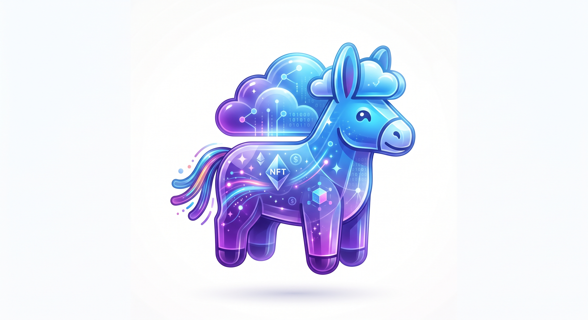

<div align="center">
    <h1>IPFS &amp; Pinata</h1>
    
    <p>
        <em>Le <strong>registre distribué</strong> (IPFS) et le service d'<strong>épinglage</strong> (Pinata) utilisés pour héberger l'image et les métadonnées du NFT.</em>
    </p>
</div>

---

## 1. Qu'est-ce qu'IPFS ?

L'**IPFS** (*InterPlanetary File System*) est un protocole **pair-à-pair** de distribution de contenu, conçu à l'origine par Juan Benet et principalement implémenté en Go.

C'est un système de fichiers **distribué** et **adressé par contenu** : chaque fichier reçoit un **CID** (*Content Identifier*), une empreinte cryptographique figée. Le même contenu produit le même CID, où que ce soit sur le réseau. Les fichiers sont répliqués entre les nœuds, ce qui les rend résistants à la censure et sans point de défaillance unique.

> [!NOTE]
> Un CID pointe vers un contenu **immuable**. Pour garantir sa disponibilité, le fichier doit être **épinglé** (*pinning*) par au moins un service — le rôle de Pinata (voir § 5).

---

## 2. Pourquoi IPFS et pas un serveur classique ?

Avant de manipuler Pinata, il faut saisir **pourquoi** on ne met pas simplement l'image sur un site web classique. C'est une question que les évaluateurs adorent poser.

### Le problème du stockage centralisé

Si l'image vit sur un seul serveur (hébergeur, site, réseau social…), tout dépend d'un point unique, qui peut :

- **tomber en panne** → l'image disparaît ;
- **fermer** ou supprimer le contenu → les liens deviennent « morts » ;
- **être censuré** ou modifié sans ton accord.

> [!IMPORTANT]
> Un NFT est censé durer et prouver durablement une propriété. Le lier à un serveur central fragile est donc contre-productif.

---

## 3. Adressage par contenu, immuabilité, déduplication

Contre l'approche centralisée, IPFS introduit deux idées majeures :

- **Adressage par contenu** : un fichier n'est pas identifié par son *emplacement* (comme une URL `/images/token.png`) mais par son *contenu*, via un **CID**. Le même contenu donne toujours le même CID, partout.
- **Déduplication et immuabilité** : deux personnes ayant le même fichier partagent le même CID. Modifier ne serait-ce qu'un pixel change complètement le CID : un CID pointe donc toujours vers un contenu **exactement identique**.

> [!WARNING]
> Un CID identifie un contenu **figé**. Si tu modifies l'image ou le JSON, tu obtiens un **nouveau CID** ; l'ancien reste intact mais pointe vers l'ancien contenu.

---

## 4. Épinglage et passerelles

- **Épinglage (*pinning*)** : sur IPFS, un fichier n'est lisible que si au moins un nœud le **maintient en ligne**. « Épingler » un fichier, c'est s'engager à le garder disponible. Sans épinglage, un contenu peut disparaître.
- **Passerelles (*gateways*)** : les navigateurs ne parlent pas IPFS nativement. Une passerelle est un site web qui traduit un CID en URL web classique :

  ```text
  https://gateway.pinata.cloud/ipfs/<CID>
  ```

> [!TIP]
> Pour l'affichage garanti dans les wallets (MetaMask, OpenSea), préfère l'**URL HTTPS de passerelle** au schéma `ipfs://` (dont la résolution dépend du wallet). C'est le choix retenu pour ce projet.

---

## 5. Pinata, le service d'épinglage

Pinata est un **service d'épinglage** (*pinning service*). Plutôt que de monter et entretenir son propre nœud IPFS (technique, coûteux, fragile), Pinata héberge et épingle les fichiers pour nous, tout en offrant une interface web, des statistiques et une API. C'est l'un des prestataires les plus utilisés dans l'écosystème NFT.

> [!TIP]
> Site : <https://www.pinata.cloud>
> Documentation : <https://docs.pinata.cloud>

### Serveur classique vs IPFS (+ Pinata)

| Critère | Serveur classique | IPFS (+ Pinata) |
| --- | --- | --- |
| Adressage | Par emplacement (URL) | Par contenu (CID) |
| Infrastructure | Centralisée, un point unique | Distribuée, pair-à-pair |
| Risque de lien mort | Élevé (panne, fermeture, censure) | Faible si épinglé |
| Modification | Possible sur place | Impossible (CID = contenu figé) |
| Durabilité | Dépend du serveur unique | Dépend de l'épinglage (géré par Pinata) |

> [!NOTE]
> **Lien avec le sujet** : le sujet exige un stockage via « registre distribué (IPFS, par exemple) ». Choisir Pinata pour héberger et épingler nos fichiers sur IPFS est donc un choix justifiable, à défendre à l'évaluation.

---

## 6. Utilisation de Pinata

L'offre **gratuite** (free) suffit largement pour ce projet : elle offre un quota de stockage et d'épinglage très large pour quelques fichiers.

### 6.1 — Créer un compte

1. Aller sur <https://www.pinata.cloud> et cliquer sur **Sign Up**.
2. Créer le compte (e-mail + mot de passe) puis confirmer.
3. Une fois connecté, on arrive sur le tableau de bord : l'onglet **Files** liste les fichiers épinglés.

> [!NOTE]
> **Clé API (optionnel)** : dans **API Keys**, on peut créer une clé (API Key + Secret) pour gérer les fichiers par programmation. Utile pour automatiser, mais pas nécessaire pour le projet. Garder le secret confidentiel.

### 6.2 — Uploader l'image

1. Onglet **Files** → **Add Files** → **File**.
2. Sélectionner l'image (`.png` ou `.jpg`) ou la déposer par glisser-déposer.
3. Cliquer sur **Upload**.
4. Le fichier apparaît dans la liste avec une colonne **CID**. Cliquer sur l'icône de copie pour le récupérer.

### 6.3 — Uploader les métadonnées (JSON)

1. Même procédure avec le fichier `code/zehd42.json`.
2. Récupérer son **CID** — il **diffère** de celui de l'image (deux contenus distincts).
3. C'est ce CID (JSON) qui sert de `baseURI` dans le contrat (voir § 9).

### 6.4 — Vérifier et comprendre

1. Tester le fichier à l'adresse `https://gateway.pinata.cloud/ipfs/<CID>` : il doit s'afficher.
2. Un CID est **unique et figé** : il identifie exactement ce contenu. Modifier le fichier donne un nouveau CID.
3. Tant que le fichier reste dans la liste Pinata (*Pinned*), il reste disponible sur IPFS. **Ne pas le supprimer du tableau de bord.**

> [!WARNING]
> **Propagation IPFS** : un fichier tout juste publié peut mettre quelques secondes à quelques minutes à être visible via toutes les passerelles. Si le lien est vide, attendre puis recharger.

---

## 7. Alternatives à Pinata

Pinata est un excellent choix, mais il n'est pas le seul : **NFT.Storage**, **Web3.Storage**, **Filebase**, **Infura IPFS**, un **nœud IPFS personnel**, ou le stockage **directement on-chain** (JSON en base64 — voir le bonus « métadonnées on-chain » du sujet).

Le sujet impose « un registre distribué (IPFS, par exemple) » : peu importe le prestataire tant que l'image et les métadonnées sont **accessibles durablement** via un identifiant de contenu.

---

## 8. Prérequis : l'image

Avant de publier sur IPFS, on prépare le « visage » du NFT :

- une image originale contenant le chiffre **42** clairement lisible (exigence du sujet) ;
- un format `.png` ou `.jpg` ;
- aucun terme ni contenu insultant (sous peine de sanctions).

> L'image n'est pas stockée dans le dépôt Git comme unique copie : le sujet exige un registre distribué (IPFS).

---

## 9. Rôle dans le projet

Deux fichiers sont publiés sur IPFS (via Pinata) :

| Fichier | Contenu | CID (IPFS) | Vérification |
| --- | --- | --- | --- |
| `images/Zehd42.png` | l'œuvre avec le **42** lisible | `bafybeiejl5obawdmnf7ptq7xx7wuttc4ri274x4vbstwby3wbcb44eejcu` | HTTP 200, `image/png`, 2 020 901 octets |
| `code/zehd42.json` | métadonnées NFT (`Zehd42`, description, image, attributs) | `bafkreibd2pph7dcwz7ewgtr73x3iwxmibux4bsb5ebqtg242n2numeb4pe` | JSON valide servi par la passerelle |

Passerelles (URL HTTPS à utiliser) :

- Métadonnées : <https://gateway.pinata.cloud/ipfs/bafkreibd2pph7dcwz7ewgtr73x3iwxmibux4bsb5ebqtg242n2numeb4pe>
- Image : <https://gateway.pinata.cloud/ipfs/bafybeiejl5obawdmnf7ptq7xx7wuttc4ri274x4vbstwby3wbcb44eejcu>

### Démarche suivie

1. Créer l'image de l'œuvre (le **42** doit être lisible).
2. Épingler `images/Zehd42.png` sur IPFS : **CID image**.
3. Rédiger `code/zehd42.json` dont le champ `image` pointe vers l'URL de passerelle du CID image.
4. Épingler `code/zehd42.json` : **CID JSON**.
5. Déployer le contrat `Zehd42` avec `_baseURI = https://gateway.pinata.cloud/ipfs/<CID_JSON>`.

---

## 10. Leçons apprises

- `tokenURI` doit pointer vers le **JSON de métadonnées**, pas directement vers l'image (sinon les wallets affichent une case vide).
- Utiliser une **URL HTTPS de passerelle** pour l'affichage garanti dans les wallets (les URI `ipfs://` dépendent de la passerelle interne du wallet).
- Vérifier qu'aucun caractère parasite (espace en tête) ne traîne dans une URL d'un fichier JSON (bug constaté en cours de projet).
